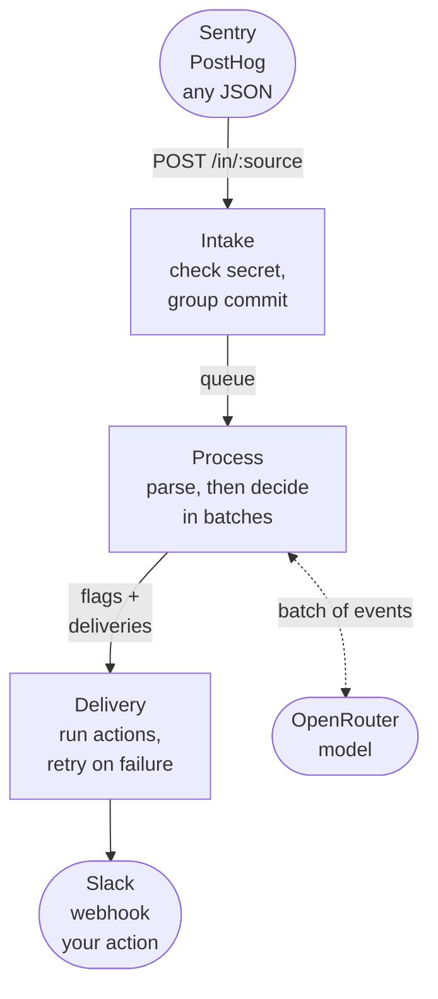

# Architecture

cloudfriend is one Node.js process and one Postgres database. Events move through three steps, and each step writes its result to the database before the next one starts:

1. **[Intake](./architecture/intake.md)** stores each request's raw bytes and replies `202`.
2. **[Process](./architecture/process.md)** parses stored requests into events and scores each one with the classifier. It then sends batches of the events that pass to a decider (Jev), which returns flags. See [Triage](./triage.md).
3. **[Delivery](./architecture/delivery.md)** runs every enabled action (Slack, webhook, your own) for each flag, retrying until it works.

Intake runs in the HTTP request. Process and delivery run in a background worker loop in the same process.

Square boxes are cloudfriend's steps and rounded boxes are outside systems. Each arrow between steps is a table in Postgres: a step hands work to the next by writing a row.

## Why it is built this way

**An acknowledged event is never lost.** cloudfriend replies `202` only after the request is committed. Every later step reads its input from a table and writes its output in one transaction, so a crash or restart at any moment leaves each event either before or after a step, never halfway. No transaction stays open across a network call (the model, an action), so a slow call never holds a lock. On startup the worker simply continues with whatever is pending.

**The request path does almost nothing.** Intake does not parse JSON or call the model. It checks the secret, appends bytes, and waits for a commit that it shares with every other request in the same ~2 ms. Slow parts (parsing, the model, Slack) cannot slow down senders.

**Batches, not single events.** The model sees up to 100 events at once. It can see that 40 errors share one cause and raise one flag for them, and one model call per batch keeps cost flat when traffic spikes.

**Everything pluggable is a file.** Sources, deciders and actions are adapters: one TypeScript file each, named after the file. You can add or replace them without rebuilding the image by mounting a directory and setting `CLOUDFRIEND_ADAPTER_DIR`.

## The data model

All state lives in Postgres, at `CLOUDFRIEND_DATABASE_URL` (or `DATABASE_URL`). Only trained model files are written to disk, under `CLOUDFRIEND_DATA_DIR/models`.

The schema is versioned SQL in `src/migrations/` (`001_init.sql`, ...). At boot, cloudfriend applies the ones not yet applied, in one transaction under a Postgres advisory lock, and records them in `schema_migrations`. When several processes start at once, one migrates and the others wait for it. Times are stored as epoch milliseconds (`bigint`), and generated ids as `bigint` identities.

Every data table has a `workspace_id` column that references `workspaces`. This release has one workspace, `ws_default`, created at boot; ingest secrets belong to a workspace, and a request's rows go to its secret's workspace.

| Table | One row per | Written by | Read by |
| --- | --- | --- | --- |
| `queue` | HTTP request, raw bytes | intake | parse |
| `events` | event, as parsed JSON plus hints | parse | decide, the API |
| `flags` | thing the decider flagged | decide | delivery, the API |
| `deliveries` | (flag, action) pair | decide | delivery |
| `labels` | training example: Jev's or a person's verdict, with the event's features | decide, feedback API | training |
| `models` | classifier training run and its report | training | the API |
| `decisions` | decider call that produced labels: its prompt and raw reply | decide | the API |
| `snapshots` | workspace's featurizer template history | worker, every minute and on shutdown | worker on start |
| `secrets` | ingest secret, SHA-256 hash only | API, CLI | intake |
| `workspaces` | workspace | boot | every table, by `workspace_id` |

A row's status column is what moves it from step to step:

| Step | Picks up | Leaves behind |
| --- | --- | --- |
| Parse | `queue.status = 'new'` | `queue.status = 'done'` (or `'failed'`), new `events` rows with `decided = false` |
| Decide | `events.decided = false` | `events.decided = true`, new `flags` rows, one `deliveries` row per action with `status = 'pending'` |
| Deliver | `deliveries.status = 'pending'` that are due | `deliveries.status = 'ok'`, or a later retry time, or `'failed'` after 15 attempts |

These status columns are the queues; there is no separate job system. Rows that more than one worker could take are claimed with `SELECT ... FOR UPDATE SKIP LOCKED`: the queue rows a parse pass reads, and the deliveries a delivery pass runs (see [Delivery](./architecture/delivery.md)).

## Retention

A cleanup job runs every minute. It deletes processed `queue` rows and decided `events` older than `CLOUDFRIEND_RETENTION` (7 days by default), 1000 rows at a time so it never holds the database for long. Events the decider has not seen yet are never deleted. Flags are kept until you delete them with `DELETE /flags/:id`.

## Adapters

| Kind | Interface | Built in |
| --- | --- | --- |
| Source | `verify?(req)` and `parse(body) → events[]` | `json` (the fallback), `sentry`, `posthog` |
| Decider | `decide(events[]) → flags[]` | `jev`, `openrouter` |
| Action | `enabled?(env)` and `run(flag, { events })` | `slack`, `webhook` |

Built-in adapters live in `src/adapters/{sources,deciders,actions}/`, and the interfaces are in `src/types.ts`. A file in `CLOUDFRIEND_ADAPTER_DIR` with the same name replaces a built-in one. Each step's page shows how its adapter is called.

## Shutdown

On `SIGTERM` (what `docker stop` sends), cloudfriend:

1. stops accepting HTTP requests,
2. stops the worker from starting new work,
3. waits up to 4 seconds for model calls and deliveries already running,
4. aborts whatever is still running, hands back the claims of interrupted deliveries, commits any requests still waiting for intake, saves the featurizer's history, closes the database connections, and exits `0`.

Aborted work is not lost. Its events and deliveries are still pending in the database and are picked up again on the next start.
