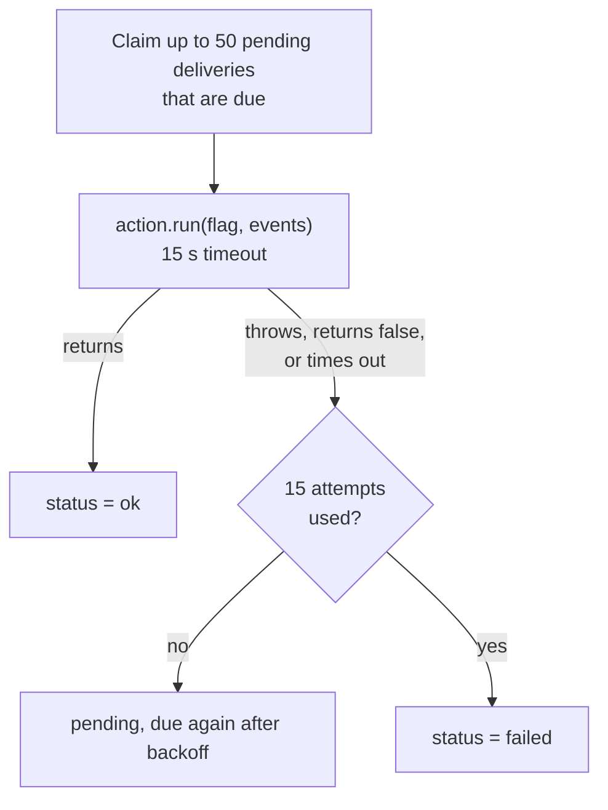

# Delivery

Delivery takes each flag from [Process](./process.md) and sends it to every destination of its workspace: post to Slack, call a webhook, or your own adapter. It retries until each delivery succeeds or runs out of attempts. Any worker runs any workspace's deliveries; they are not tied to leases.

Code: `src/worker.ts` (`claimDeliveries`, `deliverDue`, `#deliver`) and the adapters in `src/adapters/actions/`.

## The deliveries table

A destination is a row in `destinations`: its `kind` names the action adapter, and its `config` holds what that adapter needs (for example `{"url": "...", "signing_secret": "..."}`). When a flag is stored, the same transaction adds one row to `deliveries` for each destination of its workspace that isn't deleted. A flag with a Slack and a webhook destination gets two rows, and each is tracked on its own: Slack can succeed while the webhook is still retrying.

Self-hosted setups configured with `SLACK_WEBHOOK_URL` or `WEBHOOK_URL` (and `WEBHOOK_SECRET`) get those as destinations of the default workspace on the first boot where it has none. Other actions enabled by environment variables (such as your own adapter) still get one delivery each for the default workspace's flags, by name.

| Column | |
| --- | --- |
| `flag_id`, `action` | Which flag goes where. `action` is the destination's id, or an action adapter's name for env-configured actions and rows from before destinations. |
| `status` | `pending`, `ok` or `failed`. |
| `attempts` | How many times it has run. |
| `next_attempt_at` | When it is due next. While a delivery runs, this is the end of its claim. |
| `last_error` | The error from the latest failed attempt. |

`GET /flags/:id` returns these rows with the flag, with each destination's name and kind, so you can see where each flag went.

## A delivery pass

The worker starts a pass on every tick (200 ms) unless one is already running, and right after a batch produces flags.



1. Claim up to 50 `pending` deliveries of any workspace whose `next_attempt_at` has passed, earliest first. One statement selects them with `FOR UPDATE SKIP LOCKED` and moves their `next_attempt_at` a minute ahead, so another worker running a pass at the same moment skips them, and once the claim commits nobody finds them due. No transaction is open while the actions run.
2. Run them all at once. Each runs the action adapter named by its destination's `kind`, and gets the flag, up to 50 of its events and the destination's `config`, with 15 seconds.
3. Record each result, if the claim is still this pass's:
   - **success:** `status = 'ok'`, and the destination's `last_delivery_at` is set.
   - **failure** (it threw, returned `false`, or timed out): `attempts + 1`, the error message is saved on the delivery and as the destination's `last_error`, and it is due again after the backoff.
   - **15th failure:** `status = 'failed'`. It is not tried again.

If cloudfriend shuts down while an action runs, the action's `signal` fires and the claim is handed back: the delivery is due again at once on the next start. If the process dies instead, the delivery is due again when its claim runs out, a minute after it started.

If a flag is deleted while its deliveries are pending, they are deleted with it. If its destination is deleted, or an env-configured action is no longer enabled (for example its env var was removed and cloudfriend restarted), its pending deliveries are marked `failed` on their next run, without retrying.

## Retries

The wait after each failure doubles, starting at 5 seconds and capped at 1 hour:

| Attempt that failed | 1 | 2 | 3 | 4 | 5 | 6 | 7 | 8 | 9 | 10 | 11–14 |
| --- | --- | --- | --- | --- | --- | --- | --- | --- | --- | --- | --- |
| Wait before the next one | 5 s | 10 s | 20 s | 40 s | 80 s | 160 s | 5 min | 11 min | 21 min | 43 min | 1 h |

All 15 attempts span about five and a half hours, so an endpoint that is down for an afternoon still gets its flags.

## At-least-once delivery

An action can run more than once for the same flag. That happens when the action did its work but cloudfriend did not record the success, for example because:

- the endpoint processed the request but replied slowly, after the 15-second timeout, or
- cloudfriend was stopped or crashed after the call and before it saved the result.

Every flag has a stable `id`, which is the same on every attempt. Receivers that must not act twice should ignore a flag id they have already seen.

## Built-in actions

### Slack

Enabled when `SLACK_WEBHOOK_URL` is set, or configured as a workspace destination with `{ "url" }`. Posts one message per flag:

- the severity, as a colored dot and a label, and the reason
- how many events, from which sources, and the flag id
- a short sample of the first event's data

`SLACK_MIN_SEVERITY` skips flags below a severity. A skipped flag counts as delivered.

### Webhook

Enabled when `WEBHOOK_URL` is set, or configured as a workspace destination with `{ "url", "signing_secret"? }` (the destination's secret replaces `WEBHOOK_SECRET`). Sends:

```http
POST <WEBHOOK_URL>
content-type: application/json
x-cloudfriend-flag-id: flg_8c1d0e4f2a7b9c3d5e6f
x-cloudfriend-signature: sha256=<hex HMAC-SHA256 of the body, with WEBHOOK_SECRET>

{ "flag": { "id": "...", "reason": "...", "severity": "high", "event_ids": [...], ... },
  "events": [ ... up to 50 events ... ] }
```

`x-cloudfriend-signature` is only sent when `WEBHOOK_SECRET` is set. To check it on the receiving side:

```ts
import { createHmac, timingSafeEqual } from "node:crypto";

function isFromCloudfriend(rawBody: string, header: string | undefined, secret: string): boolean {
  const expected = "sha256=" + createHmac("sha256", secret).update(rawBody).digest("hex");
  return !!header && header.length === expected.length && timingSafeEqual(Buffer.from(header), Buffer.from(expected));
}
```

Any `2xx` reply counts as delivered. Anything else, including a redirect, is retried.

A test message from the dashboard has the same shape and signature, with `"test": true` in the body, a flag id starting `flg_test_`, and the header `x-cloudfriend-test: 1`.

## Outbound requests

Slack and webhook URLs can be typed into the dashboard by anyone who manages a workspace, and cloudfriend sends to them from inside your network. So every request to a destination goes through `src/net/outbound.ts`, which applies these rules:

- **https only.** No user name or password in the URL.
- **Public addresses only.** The host is resolved (A and AAAA), and if any address it resolves to is not public, the destination is refused. Not public: loopback, private (`10/8`, `172.16/12`, `192.168/16`), link-local (`169.254/16`, which includes the cloud metadata address `169.254.169.254` and the ECS endpoint `169.254.170.2`, and `fe80::/10`), carrier-grade NAT (`100.64/10`), `0.0.0.0/8`, multicast, broadcast, documentation and other reserved ranges, IPv6 unique local (`fc00::/7`), and IPv6 forms that carry one of those IPv4 addresses (`::ffff:10.0.0.1`, NAT64 `64:ff9b::/96`, 6to4). IP literals count in any notation: `https://2130706433/` is `127.0.0.1`.
- **Checked again when connecting.** The host is resolved again at connect time, every address is checked again, and the connection goes only to a checked address. A DNS answer that changes between the check and the send (DNS rebinding) is refused.
- **No redirects.** A `3xx` reply is a failed delivery, like any other non-`2xx`.
- **15-second timeout**, and at most 4 KB of the reply is read. The rest is discarded.
- **Status-only errors.** `last_error` says `slack replied 404`, `webhook replied 500`, `destination refused: private address`, `timed out` or `connection refused`, never anything from the reply body.

The same check runs when a destination is saved (`validate`): a Slack destination must also be an `https://hooks.slack.com/...` URL, and a webhook's optional `signing_secret` must be at least 16 characters.

To send to private addresses, for example a webhook receiver on your own network when self-hosting, set `CLOUDFRIEND_ALLOW_PRIVATE_DESTINATIONS=on` (`true`, `1` and `yes` also work). Then private and loopback addresses and `http` URLs are allowed, and any URL may be used for Slack. The other rules still apply. This also covers `SLACK_WEBHOOK_URL` and `WEBHOOK_URL`: without it, an `http` or private URL there fails every delivery with `destination refused: ...`.

## Choosing actions

Destinations are added per workspace in the dashboard or API. For the default workspace's env-configured actions, every action whose `enabled()` says yes is used by default; to pick explicitly, set `CLOUDFRIEND_ACTIONS=slack,webhook`. The list applies to flags created after cloudfriend starts with it. Deliveries already in the table keep the destinations they were created with.

## Action adapter: `run`

```ts
// actions/pagerduty.ts
import type { ActionAdapter } from "../../src/types.ts";

export default {
  enabled: (env) => Boolean(env.PAGERDUTY_ROUTING_KEY),
  async run(flag, { env, events, signal }) {
    if (flag.severity !== "critical") return;
    const res = await fetch("https://events.pagerduty.com/v2/enqueue", {
      method: "POST",
      signal,
      headers: { "content-type": "application/json" },
      body: JSON.stringify({
        routing_key: env.PAGERDUTY_ROUTING_KEY,
        event_action: "trigger",
        dedup_key: flag.id, // at-least-once: let PagerDuty drop repeats
        payload: { summary: flag.reason, severity: "critical", source: events[0]?.source ?? "cloudfriend" },
      }),
    });
    if (!res.ok) throw new Error(`pagerduty ${res.status}`); // retried with backoff
  },
} satisfies ActionAdapter;
```

- Return normally for success. Throw, or return `false`, to retry.
- Pass `signal` to `fetch`. It fires on the 15-second timeout and on shutdown.
- Keep `run` short. Slow work, such as an agent investigating the flag, belongs downstream: send the flag somewhere that queues the work, and return.
