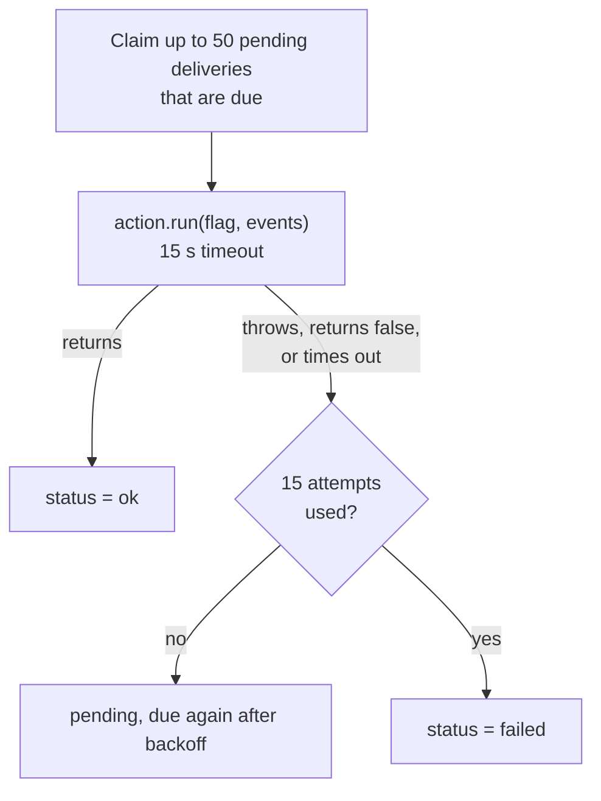

# Delivery

Delivery takes each flag from [Process](./process.md) and runs every enabled action on it: post to Slack, call a webhook, or your own adapter. It retries until each action succeeds or runs out of attempts.

Code: `src/worker.ts` (`claimDeliveries`, `deliverDue`, `#deliver`) and the adapters in `src/adapters/actions/`.

## The deliveries table

When a flag is stored, the same transaction adds one row to `deliveries` for each enabled action. A flag with Slack and a webhook enabled gets two rows, and each is tracked on its own: Slack can succeed while the webhook is still retrying.

| Column | |
| --- | --- |
| `flag_id`, `action` | Which flag goes to which action. |
| `status` | `pending`, `ok` or `failed`. |
| `attempts` | How many times it has run. |
| `next_attempt_at` | When it is due next. While a delivery runs, this is the end of its claim. |
| `last_error` | The error from the latest failed attempt. |

`GET /flags/:id` returns these rows with the flag, so you can see where each flag went.

## A delivery pass

The worker starts a pass on every tick (200 ms) unless one is already running, and right after a batch produces flags.



1. Claim up to 50 `pending` deliveries whose `next_attempt_at` has passed, earliest first. One statement selects them with `FOR UPDATE SKIP LOCKED` and moves their `next_attempt_at` a minute ahead, so another worker running a pass at the same moment skips them, and once the claim commits nobody finds them due. No transaction is open while the actions run.
2. Run them all at once. Each gets the flag and up to 50 of its events, and has 15 seconds.
3. Record each result, if the claim is still this pass's:
   - **success:** `status = 'ok'`.
   - **failure** (it threw, returned `false`, or timed out): `attempts + 1`, the error is saved, and it is due again after the backoff.
   - **15th failure:** `status = 'failed'`. It is not tried again.

If cloudfriend shuts down while an action runs, the action's `signal` fires and the claim is handed back: the delivery is due again at once on the next start. If the process dies instead, the delivery is due again when its claim runs out, a minute after it started.

If a flag is deleted while its deliveries are pending, they are deleted with it. If an action is no longer enabled (for example its env var was removed and cloudfriend restarted), its pending deliveries are marked `failed` on their next run.

## Retries

The wait after each failure doubles, starting at 5 seconds and capped at 1 hour:

| Attempt that failed | 1 | 2 | 3 | 4 | 5 | 6 | 7 | 8 | 9 | 10 | 11–14 |
| --- | --- | --- | --- | --- | --- | --- | --- | --- | --- | --- | --- |
| Wait before the next one | 5 s | 10 s | 20 s | 40 s | 80 s | 160 s | 5 min | 11 min | 21 min | 43 min | 1 h |

All 15 attempts span about five and a half hours, so an endpoint that is down for an afternoon still gets its flags.

## At-least-once delivery

An action can run more than once for the same flag. That happens when the action did its work but cloudfriend did not record the success, for example because:

- the endpoint processed the request but replied slowly, after the 15-second timeout, or
- cloudfriend was stopped or crashed after the call and before it saved the result.

Every flag has a stable `id`, which is the same on every attempt. Receivers that must not act twice should ignore a flag id they have already seen.

## Built-in actions

### Slack

Enabled when `SLACK_WEBHOOK_URL` is set. Posts one message per flag:

- the severity, as a colored dot and a label, and the reason
- how many events, from which sources, and the flag id
- a short sample of the first event's data

`SLACK_MIN_SEVERITY` skips flags below a severity. A skipped flag counts as delivered.

### Webhook

Enabled when `WEBHOOK_URL` is set. Sends:

```http
POST <WEBHOOK_URL>
content-type: application/json
x-cloudfriend-flag-id: flg_8c1d0e4f2a7b9c3d5e6f
x-cloudfriend-signature: sha256=<hex HMAC-SHA256 of the body, with WEBHOOK_SECRET>

{ "flag": { "id": "...", "reason": "...", "severity": "high", "event_ids": [...], ... },
  "events": [ ... up to 50 events ... ] }
```

`x-cloudfriend-signature` is only sent when `WEBHOOK_SECRET` is set. To check it on the receiving side:

```ts
import { createHmac, timingSafeEqual } from "node:crypto";

function isFromCloudfriend(rawBody: string, header: string | undefined, secret: string): boolean {
  const expected = "sha256=" + createHmac("sha256", secret).update(rawBody).digest("hex");
  return !!header && header.length === expected.length && timingSafeEqual(Buffer.from(header), Buffer.from(expected));
}
```

Any `2xx` reply counts as delivered. Anything else is retried.

## Choosing actions

By default every action whose `enabled()` says yes is used. To pick explicitly, set `CLOUDFRIEND_ACTIONS=slack,webhook`. The list applies to flags created after cloudfriend starts with it. Deliveries already in the table keep the actions they were created with.

## Action adapter: `run`

```ts
// actions/pagerduty.ts
import type { ActionAdapter } from "../../src/types.ts";

export default {
  enabled: (env) => Boolean(env.PAGERDUTY_ROUTING_KEY),
  async run(flag, { env, events, signal }) {
    if (flag.severity !== "critical") return;
    const res = await fetch("https://events.pagerduty.com/v2/enqueue", {
      method: "POST",
      signal,
      headers: { "content-type": "application/json" },
      body: JSON.stringify({
        routing_key: env.PAGERDUTY_ROUTING_KEY,
        event_action: "trigger",
        dedup_key: flag.id, // at-least-once: let PagerDuty drop repeats
        payload: { summary: flag.reason, severity: "critical", source: events[0]?.source ?? "cloudfriend" },
      }),
    });
    if (!res.ok) throw new Error(`pagerduty ${res.status}`); // retried with backoff
  },
} satisfies ActionAdapter;
```

- Return normally for success. Throw, or return `false`, to retry.
- Pass `signal` to `fetch`. It fires on the 15-second timeout and on shutdown.
- Keep `run` short. Slow work, such as an agent investigating the flag, belongs downstream: send the flag somewhere that queues the work, and return.
