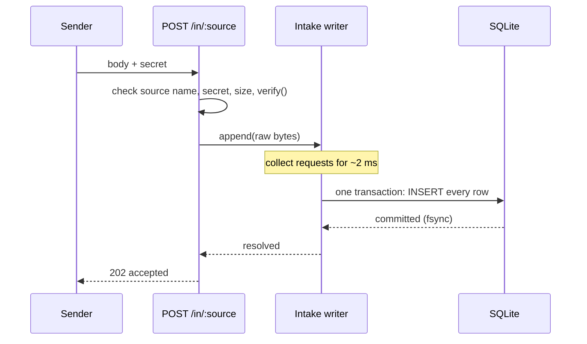

# Intake

Intake is the only part of cloudfriend that runs while a sender waits. Its job is narrow: get the request's bytes onto disk and say so. Everything else happens later, in [Process](./process.md).

Code: `src/server.ts` (the `POST /in/:source` route) and `src/intake.ts`.

## What happens to a request



In order:

1. **Source name.** The `:source` part must be 1 to 64 characters of lowercase letters, digits, `-` and `_`, starting with a letter or digit. Anything else gets `404`.
2. **Secret.** Read from `Authorization: Bearer <secret>`, or from `?secret=` for senders that cannot set headers. cloudfriend hashes it with SHA-256 and looks up the hash. A missing, unknown or revoked secret, or a secret limited to another source, gets `401`.
3. **Size.** A body over `CLOUDFRIEND_MAX_BODY_BYTES` (1 MiB by default) gets `413`. A too-large `Content-Length` is rejected before the body is read.
4. **`verify()`.** If the source adapter has a `verify` function, it runs now. The Sentry adapter uses this to check the `Sentry-Hook-Signature` HMAC when `SENTRY_CLIENT_SECRET` is set. A `false` gets `401`.
5. **Append.** The raw bytes go to the intake writer with the source name and the time received. The request waits until they are committed.
6. **Reply.** `202 accepted` once committed. `503` with `Retry-After: 5` if the write failed or the queue is full.

The body is never parsed here. A malformed JSON body is accepted and stored, and the parse step deals with it later.

## Group commit

A durable write needs an fsync, and an fsync takes about as long for one row as for a thousand. So the intake writer does not commit each request on its own:

- The first request to arrive starts a timer of `CLOUDFRIEND_COMMIT_WINDOW` (2 ms by default).
- Every request that arrives before the timer fires joins the same batch.
- When the timer fires, the whole batch is inserted into the `queue` table in one transaction, so one fsync covers all of it.
- Every request in the batch then gets its `202` together. If the transaction fails, every request in it gets `503`.

The same transaction also updates `last_used_at` on the secrets that were used, so that costs no extra write.

On a laptop with `CLOUDFRIEND_SYNCHRONOUS=FULL`, 50 concurrent senders get their `202` in about 3 ms at the median, at roughly 16,000 requests per second.

## Durability settings

The database runs in WAL mode. `CLOUDFRIEND_SYNCHRONOUS` decides how hard each commit is pushed to disk:

| Setting | Survives a process crash | Survives power loss | Speed |
| --- | --- | --- | --- |
| `FULL` (default) | yes | yes | baseline |
| `NORMAL` | yes | the last few commits may be lost | faster |

With `FULL`, a `202` means the event is on disk.

## Backpressure

If the worker falls behind (the model is down, or a burst is bigger than parsing can keep up with), unparsed requests pile up in `queue`. Intake keeps a count of them in memory, so checking it costs nothing per request.

Once the count reaches `CLOUDFRIEND_MAX_QUEUE` (one million by default), new requests get `503` with `Retry-After: 5` instead of growing the database without limit. Senders that retry (Sentry, PostHog and most webhook senders do) deliver the event later. `GET /healthz` reports the current count as `queued`.

Note that the queue only holds requests that are not yet parsed. Parsed events waiting for the model sit in `events` and do not count toward the limit.

## Responses

| Status | Meaning | Sender should |
| --- | --- | --- |
| `202` | Stored on disk. | Move on. |
| `401` | Bad or missing secret, or `verify()` failed. | Fix its configuration. |
| `404` | Invalid source name. | Fix the URL. |
| `413` | Body too large. | Send smaller requests, or raise `CLOUDFRIEND_MAX_BODY_BYTES`. |
| `503` | Queue full or storage failed. Nothing was stored. | Retry after `Retry-After` seconds. |

## Tuning

| Variable | Default | Raise it to | Lower it to |
| --- | --- | --- | --- |
| `CLOUDFRIEND_COMMIT_WINDOW` | `2ms` | batch more per fsync under heavy load | reply sooner when traffic is light |
| `CLOUDFRIEND_SYNCHRONOUS` | `FULL` | | `NORMAL` for speed, if losing the last moments on power loss is acceptable |
| `CLOUDFRIEND_MAX_QUEUE` | `1000000` | absorb longer outages of the worker | push back on senders sooner |
| `CLOUDFRIEND_MAX_BODY_BYTES` | `1048576` | accept large batches in one request | reject oversized payloads |

## Source adapter: `verify`

`verify` is the only adapter code that runs during intake, so it must be cheap: check a header or an HMAC, with no network calls and no JSON parsing.

```ts
// sources/stripe.ts
import type { SourceAdapter } from "../../src/types.ts";

export default {
  // req: { source, headers (lower-case names), query, body }
  verify(req) {
    return Boolean(req.headers["stripe-signature"]);
  },
  // Runs later, in the worker. See Process.
  parse(body) {
    return [{ data: JSON.parse(new TextDecoder().decode(body)) }];
  },
} satisfies SourceAdapter;
```
