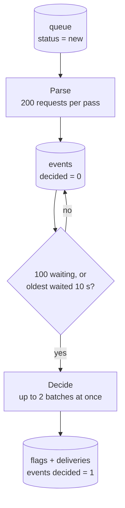

# Process

Process turns stored requests into flags. It has two stages, both run by the background worker:

1. **Parse** turns each raw request from [Intake](./intake.md) into one or more events.
2. **Decide** sends batches of events to the decider, which returns flags.

Each stage reads its input from one table and writes its output in one transaction, so a crash between or during them loses nothing.

Code: `src/worker.ts` (`parseNew`, `startDueBatches`, `#decideBatch`, `#storeDecision`) and the adapters in `src/adapters/sources/` and `src/adapters/deciders/`.



## The worker loop

The worker wakes every `CLOUDFRIEND_POLL_INTERVAL` (200 ms) and, in order:

1. parses new requests until none are left,
2. starts a decide call for every batch that is ready,
3. starts a [delivery](./delivery.md) pass if one is not already running.

Parsing is synchronous and quick. Decide calls and deliveries are network calls, so the loop starts them and moves on instead of waiting.

## Parse

Parse reads up to 200 `queue` rows with `status = 'new'`, oldest first, and runs each through the source adapter with the same name as its source. A source with no adapter of that name uses `json`.

| Adapter | Turns a request into |
| --- | --- |
| `json` | One event per JSON object. An array or newline-delimited JSON gives one event per item. Text that is not JSON becomes `{ "raw": "..." }`. An empty body gives no events. |
| `sentry` | One event per issue, error, event alert or metric alert webhook, with the Sentry id, the webhook type (such as `issue.created`) and a group key per Sentry issue (`issue:<id>`) or metric alert. Installation webhooks are dropped. |
| `posthog` | One event per PostHog event, including each item of a `{ "batch": [...] }`. Events are grouped by event name, and `$exception` events by fingerprint or exception type. |

Each event is stored with its JSON `data` and three optional hints set by the adapter:

- `external_id`: the sender's own id for it
- `type`: the event type, such as `issue.created`
- `group_key`: events with the same key probably share a cause

Deciders use the hints when they are there and work without them.

All events from the pass, and the new status of each request, are written in one transaction. A request becomes `done`, or `failed` if its adapter threw. A failed request is kept, not retried, and logged with its queue id so you can look at the body.

### Source adapter: `parse`

```ts
// sources/stripe.ts
import type { SourceAdapter } from "../../src/types.ts";

export default {
  parse(body, { source, received_at }) {
    const evt = JSON.parse(new TextDecoder().decode(body));
    if (evt.type?.startsWith("customer.")) return []; // drop
    return [{ data: evt, id: evt.id, type: evt.type, group_key: evt.data?.object?.id }];
  },
} satisfies SourceAdapter;
```

Return an array. Only `data` is required. Return `[]` to drop a request, and throw to mark it `failed`.

## Decide

### When a batch is ready

Decide looks at events with `decided = 0`, oldest first. It starts a batch when either:

- `CLOUDFRIEND_BATCH_SIZE` events (100) are waiting, or
- the oldest waiting event arrived `CLOUDFRIEND_BATCH_WAIT` (10 s) ago or more.

So under heavy traffic the model gets full batches as fast as it can take them, and under light traffic no event waits more than about 10 seconds.

Up to `CLOUDFRIEND_DECIDER_CONCURRENCY` (2) batches are decided at once. Events already in a running batch are skipped when the next batch is built, so no event is in two batches at the same time.

### What the decider returns

A decider gets the batch and returns flag drafts:

```json
[
  {
    "reason": "Checkout TypeError started after deploy, 14 events in 2 minutes",
    "severity": "high",
    "event_ids": ["1041", "1042", "1057"]
  }
]
```

`severity` is one of `low`, `medium`, `high` or `critical`. An empty array means nothing in the batch needs attention, which is the usual answer.

cloudfriend then, in one transaction:

1. drops drafts with no reason, and event ids that are not in this batch,
2. stores each remaining flag with a new id such as `flg_8c1d0e4f2a7b9c3d5e6f`,
3. adds one `deliveries` row per enabled action for each flag,
4. marks every event in the batch `decided = 1`, flagged or not.

### The default decider: OpenRouter

The `openrouter` decider makes one chat completion per batch:

- **System prompt.** Describes cloudfriend's job: flag new or unusual errors, spikes, regressions after deploys, outages, data loss, security problems, and failures in checkout, payments or signup. Ignore routine logs, isolated handled errors and normal analytics. Group events with the same cause into one flag. `CLOUDFRIEND_DECIDER_INSTRUCTIONS` is appended as operator context.
- **User message.** The batch, oldest first. Each event is a numbered line with its source, time, type and group, then its data as compact JSON cut to `CLOUDFRIEND_EVENT_CHARS` (1500) characters. Plain fields come before nested ones, so the cut removes stack frames rather than the error title.
- **Reply.** JSON only, `{"flags": [{"reason", "severity", "events": [0, 3]}]}`, with `temperature: 0`. The numbers are mapped back to event ids. Unknown numbers are ignored, and an unknown severity becomes `medium`.

The model is `OPENROUTER_MODEL` (`anthropic/claude-haiku-5.5` by default), and each call times out after 90 seconds. `OPENROUTER_BASE_URL` points it at any OpenAI-compatible endpoint instead.

Without `OPENROUTER_API_KEY` the decider is off. Events are still parsed and stored, and they are decided once a key is set and cloudfriend restarts.

### When the decider fails

If the call throws (model down, bad key, unreadable reply), nothing is written: the events stay `decided = 0` and are tried again. Retries back off from 1 second, doubling up to 5 minutes, and reset after the first success. Events are never dropped because the model was unavailable.

### Decider adapter: `decide`

```ts
// deciders/rules.ts
import type { DeciderAdapter } from "../../src/types.ts";

export default {
  async decide(events, { env, signal }) {
    const fatal = events.filter((e) => (e.data as any)?.level === "fatal");
    return fatal.length
      ? [{ reason: `${fatal.length} fatal errors`, severity: "critical", event_ids: fatal.map((e) => e.id) }]
      : [];
  },
} satisfies DeciderAdapter;
```

Each event has `id`, `source`, `received_at`, `data` and the optional hints. Pass `signal` to any `fetch`, so the call is cancelled on shutdown. Select it with `CLOUDFRIEND_DECIDER=rules`.

## Tuning

| Variable | Default | Effect |
| --- | --- | --- |
| `CLOUDFRIEND_BATCH_SIZE` | `100` | Larger batches give the model more context and cost less per event, but each call is slower. |
| `CLOUDFRIEND_BATCH_WAIT` | `10s` | The longest an event waits before it is decided. |
| `CLOUDFRIEND_DECIDER_CONCURRENCY` | `2` | Raise it if flags arrive later and later under steady traffic, which means batches are waiting for a free decide slot. |
| `CLOUDFRIEND_EVENT_CHARS` | `1500` | How much of each event the model sees. |
| `CLOUDFRIEND_POLL_INTERVAL` | `200ms` | How often the idle worker checks for new work. |
