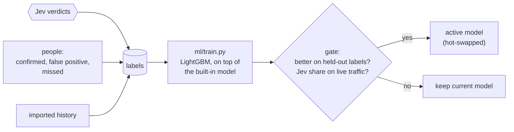

# Training

The classifier in front of Jev is meant to get better at your traffic. Every decision Jev makes, and every correction a person makes, becomes a labelled example. A training loop turns those examples into a new LightGBM model, checks it against the current one, and swaps it in. A better classifier rules out more events on its own, so less of the stream reaches Jev and you pay for fewer calls.



Code: `src/training.ts`, `src/feedback.ts`, `ml/train.py`.

## Where labels come from

Each label is stored with the feature vector the classifier saw when the event arrived, so the training data matches what the model will see in production. Labels outlive event retention.

| Source | Label | How |
| --- | --- | --- |
| Jev | every example Jev read, and up to 10 of its followers: escalate if Jev flagged it, else don't | automatic |
| Audit samples | 1% of dropped events go to Jev; its answer is a label. A "yes" here is a **false negative** the classifier would have missed | automatic |
| Confirmed flags | every event of the flag: escalate | `POST /flags/:id/feedback {"verdict": "confirmed"}` |
| False positives | every event of the flag: don't escalate. Jev's cached verdict for those templates is overturned | `POST /flags/:id/feedback {"verdict": "false_positive"}` |
| Missed escalations | one event that should have been escalated (or not) | `POST /events/:id/feedback {"escalate": true}` |
| History | events cloudfriend never saw, e.g. last quarter's incidents from another tool | `POST /labels` or `cloudfriend labels import` |

A person's label replaces Jev's label for the same event, never the other way round. During training a person's label counts five times as much as Jev's (`CLOUDFRIEND_HUMAN_LABEL_WEIGHT`).

`POST /events/:id/feedback` tells you what kind of mistake it was:

```bash
curl -X POST localhost:8080/events/1041/feedback -H "Authorization: Bearer $CLOUDFRIEND_ADMIN_KEY" \
  -d '{"escalate": true, "note": "this was the start of the outage"}'
# {"event":"1041","labeled":true,"escalate":true,"score":0.004,"route":"drop","was_escalated":false,"kind":"false_negative"}
```

Imported history is featurized in time order, with a fresh featurizer per import. Each line of an import file is one event:

```bash
cloudfriend labels import incidents.ndjson
# {"source": "sentry", "received_at": "2026-09-14T08:02:11Z", "data": {...}, "escalate": true}
# {"source": "app-logs", "data": {"level": "warn", "message": "cache miss"}, "escalate": false}
```

`GET /labels` counts labels by source and verdict, and how many arrived since the last training run.

## A training run

`cloudfriend train` (in the container: `docker exec <container> cloudfriend train`), `POST /model/train`, or the schedule all do the same thing:

1. **Export.** Labels from the current featurizer version, oldest first. The oldest 80% are for training and the newest 20% are held out. Splitting by time asks the right question: does a model trained on the past do well on what came next? A run needs at least 20 labels, with escalations and non-escalations in both parts. Otherwise it is recorded as `skipped`.
2. **Train.** `ml/train.py` boosts up to 200 new trees on top of the built-in model (`models/base.lgb.txt`), with early stopping on the held-out labels. A few hundred of your labels refine the built-in model rather than replace it. The script also picks the thresholds:
   - `drop_below`: the highest score that still sends 98% of held-out escalations to Jev (`CLOUDFRIEND_RECALL_TARGET`).
   - `threshold`: the score with the best F1, used when there is no Jev.
3. **Gate.** The candidate and the active model both score the held-out labels. The candidate is promoted only if:
   - it still sends at least the recall target minus 2 points of held-out escalations to Jev, and
   - its average precision is no more than 0.01 below the active model's.
4. **Limit.** Labels only exist for events Jev saw, so a threshold fitted on them can be far too bold for the traffic Jev never sees. Before the gate, both models score the 50,000 most recent events. If the candidate would send less than half the share of events the active model sends to Jev, its `drop_below` is lowered until it sends exactly half. Thresholds therefore move one step per run, and audit samples check each step.
5. **Promote.** The model is written to `/data/models/active.json` and swapped in without a restart. A running server also picks up a model promoted by `cloudfriend train` in another process within 30 seconds.

Every run is recorded with its report: label counts, both models' metrics, and the share of recent events each would send to Jev.

```bash
cloudfriend train --dry-run   # train and gate, but don't promote
cloudfriend model             # the active model and the last runs
curl -H "Authorization: Bearer $CLOUDFRIEND_ADMIN_KEY" localhost:8080/model
```

```json
{
  "id": "mdl_20261026203009_b7d1ba",
  "status": "promoted",
  "reason": "average precision 1.000 vs 1.000; Jev would see 32.6% of events vs 45.6%",
  "labels": { "total": 1712, "positives": 1186, "human": 1186, "train": 1369, "holdout": 343 },
  "recent": { "events": 50000, "active": 0.0144, "candidate": 0.0129, "adjusted": false }
}
```

This report is from a real run. Two RCAEval cases were replayed into a server with live Jev, and its four flags were confirmed through the API. The new model sends 1.29% of recent traffic to Jev instead of 1.44%.

## What retraining does to stage-1 false positives

A **stage-1 false positive** is an event the classifier passes on to Jev, where Jev decides it isn't worth escalating. It is never flagged, because only Jev raises flags. But every one costs a Jev call. Jev's "no" is stored as a label, and the next training run teaches the classifier to drop that kind of event itself.

`test/triage.test.ts` ("stops sending Jev what Jev keeps rejecting") checks this end to end through the server:

1. The classifier passes slow-cache warnings and payment failures alike to Jev.
2. Jev rejects the warnings and escalates the payments.
3. After one `train`, new warnings are dropped by the classifier and only the payments still reach Jev.

On benchmark data we measured the same effect. We started from a classifier trained only on GAIA, collected about 12,000 Jev verdicts while replaying RCAEval cases, and retrained on them. We then looked at three faults whose cases were left out of training:

| On held-out faults | Before retraining | After |
| --- | --- | --- |
| Stage-1 false positives (passed on, Jev said no) | 547 sent to Jev | 91 sent to Jev (83% now dropped by the classifier) |
| Jev's escalations | 74 sent to Jev | 68 sent to Jev (92% still reach Jev) |

The events that still go to Jev after retraining look like real escalations to the classifier. Jev keeps answering "no" for them, and its cached verdict covers repeats for 15 minutes. Error templates the classifier has never seen also go to Jev once whatever their score, so a brand-new failure is not lost to a confident classifier.

### What Jev said yes to keeps reaching Jev

The reverse matters as much: once Jev escalates a kind of event, the classifier must never drop the next one. Look at the 8% of escalations above that the retrained classifier misses. They are `frontend request error` lines that score almost zero. They only reached Jev through the 1% audit sample, and Jev escalated them: stage-1 false negatives.

Lowering the threshold doesn't fix this. At a 99.5% recall target instead of 98%, the classifier caught one more escalation but sent three times as many stage-1 false positives to Jev (272 instead of 91). The fix is a rule instead. A template that Jev or a person escalated in the last 7 days goes to Jev whatever its score (route `known`, see [Triage](./triage.md#routes)). Replaying the three held-out faults with Jev's recorded verdicts:

| Later events of a kind Jev had escalated | Reach Jev |
| --- | --- |
| classifier alone | 3,086 of 12,035 (25.6%) |
| classifier + escalated-kind rule | 12,035 of 12,035 (100%) |

Most of them cost no Jev call: they are added to the open flag by Jev's cached verdict. The rule only covers kinds that were escalated, so it brings back none of the stage-1 false positives. A person marking the flag `false_positive` takes its templates off the list at once. The list survives restarts: it is rebuilt from the labels table.

A flag that Jev raised and a person marks `false_positive` works the same way. Its events become "don't escalate" labels with five times the weight, and Jev's cached verdict for those templates is overturned at once, before any retraining.

## Schedule

Retraining runs every `CLOUDFRIEND_RETRAIN_INTERVAL` (24 hours), but only once `CLOUDFRIEND_RETRAIN_MIN_LABELS` (200) new labels have arrived since the last run. Set the interval to `off` to retrain only by hand.

Training needs Python 3 with LightGBM and numpy, which the image includes. Outside Docker, set `CLOUDFRIEND_PYTHON` to an interpreter that has them. Scoring needs neither: the trees are evaluated in TypeScript (`src/triage/gbdt.ts`), and a test checks that its scores match LightGBM's own.

## Configuration

| Variable | Default | |
| --- | --- | --- |
| `CLOUDFRIEND_RETRAIN_INTERVAL` | `24h` | How often to check for enough new labels. `off` disables. |
| `CLOUDFRIEND_RETRAIN_MIN_LABELS` | `200` | New labels needed before a scheduled run. |
| `CLOUDFRIEND_HUMAN_LABEL_WEIGHT` | `5` | Weight of a person's label relative to Jev's. |
| `CLOUDFRIEND_RECALL_TARGET` | `0.98` | Share of escalations that must still reach Jev. |
| `CLOUDFRIEND_PYTHON` | `python3` | Interpreter for `ml/train.py`. |

## The built-in model

`models/base.json` is trained on public benchmark data: RCAEval RE3 (code-level faults in three microservice systems) and two weeks of GAIA MicroSS (a login system with injected faults). [Benchmarks](./benchmarks.md) describes the data, the splits and how well it does, and `ml/README.md` has the commands to rebuild it.
