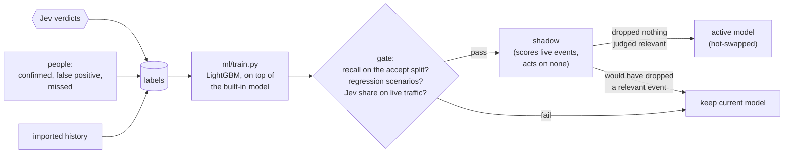

# Training

The classifier in front of Jev is meant to get better at your traffic. Every decision Jev makes, and every correction a person makes, becomes a labelled example. A training loop turns those examples into a new LightGBM model, checks it against the current one, and swaps it in. A better classifier rules out more events on its own, so less of the stream reaches Jev and you pay for fewer calls.



Code: `src/training.ts`, `src/feedback.ts`, `ml/train.py`.

## Where labels come from

Each label is stored with the feature vector the classifier saw when the event arrived, so the training data matches what the model will see in production. Labels outlive event retention. Each also records its **provenance** (how the event came to be judged), a training **weight**, and the **decision** it came from: `GET /decisions/:id` returns that call's exact prompt and raw reply.

Jev judges every event it reads: `relevant` (worth a person's attention), `benign`, or `uncertain`. Only `relevant` and `benign` become labels. An event Jev calls `uncertain`, or doesn't judge at all, gets no label: silence is never read as "don't escalate". Whether to notify anyone is a separate decision. Jev may judge an event relevant and attach it to an alert that is already open instead of raising a new one.

| Source | Label | Provenance and weight | How |
| --- | --- | --- | --- |
| Jev | every example Jev judged relevant or benign | `threshold`, `novel` or `known` (the route that sent it), 1 | automatic |
| Jev, followers | up to 10 of the events an example stood for (same template and severity, not shown to Jev) take the example's judgment | `follower`, 0.2 | automatic |
| Audit samples | 1% of dropped events go to Jev; its judgment is a label. A "relevant" here is a **false negative** the classifier would have missed | `audit`, 1 / audit rate (at most 10), since each stands for the many drops that weren't sampled | automatic |
| Confirmed flags | every event of the flag: escalate | `human`, 5 | `POST /flags/:id/feedback {"verdict": "confirmed"}` |
| False positives | every event of the flag: don't escalate. Jev's cached verdict for those templates is overturned | `human`, 5 | `POST /flags/:id/feedback {"verdict": "false_positive"}` |
| Missed escalations | one event that should have been escalated (or not). An "escalate" clears any cached "no" for its template and sends later events of it to Jev | `human`, 5 | `POST /events/:id/feedback {"escalate": true}` |
| History | events cloudfriend never saw, e.g. last quarter's incidents from another tool | `import`, 5 | `POST /labels` or `cloudfriend labels import` |

A person's label replaces Jev's label for the same event, never the other way round. During training a person's label counts five times as much as Jev's (`CLOUDFRIEND_HUMAN_LABEL_WEIGHT`).

`POST /events/:id/feedback` tells you what kind of mistake it was:

```bash
curl -X POST localhost:8080/events/1041/feedback -H "Authorization: Bearer $CLOUDFRIEND_ADMIN_KEY" \
  -d '{"escalate": true, "note": "this was the start of the outage"}'
# {"event":"1041","labeled":true,"escalate":true,"score":0.004,"route":"drop","was_escalated":false,"kind":"false_negative"}
```

Imported history is featurized in time order, with a fresh featurizer per import. Each line of an import file is one event:

```bash
cloudfriend labels import incidents.ndjson
# {"source": "sentry", "received_at": "2026-09-14T08:02:11Z", "data": {...}, "escalate": true}
# {"source": "app-logs", "data": {"level": "warn", "message": "cache miss"}, "escalate": false}
```

`GET /labels` counts labels by source and verdict, and how many arrived since the last training run.

## A training run

`cloudfriend train` (in the container: `docker exec <container> cloudfriend train`), `POST /model/train`, or the schedule all do the same thing:

1. **Split.** Labels from the current featurizer version are split by time into three parts: **fit** (oldest 60%), **calibrate** (next 20%) and **accept** (newest 20%). A run of labels of one template with gaps under `CLOUDFRIEND_INCIDENT_WINDOW` (30 minutes) is one incident and stays in one part. It is capped at four windows, so a template that never goes quiet doesn't swallow the split. Splitting by time asks the right question: does a model trained on the past do well on what came next? A run needs at least 30 labels, with escalations and non-escalations in every part. Otherwise it is recorded as `skipped`.
2. **Train.** `ml/train.py` boosts up to 200 new trees on top of the built-in model (`models/base.lgb.txt`) on the fit part, with each label's weight. Early stopping and thresholds use the calibrate part only. A few hundred of your labels refine the built-in model rather than replace it. The thresholds:
   - `drop_below`: the highest score that still sends `CLOUDFRIEND_RECALL_TARGET` (99.5%) of the calibrate part's escalations to Jev.
   - `threshold`: the score with the best F1, used when there is no Jev.
3. **Limit.** Labels only exist for events Jev saw, so a threshold fitted on them can be far too bold for the traffic Jev never sees. Both models score the 50,000 most recent events. If the candidate would send less than half the share of events the active model sends to Jev, its `drop_below` is lowered until it sends exactly half. Thresholds therefore move one step per run, and audit samples check each step.
4. **Gate.** The accept part is used here and nowhere else. These are hard requirements, not a comparison with the active model:
   - the candidate sends at least the recall target (99.5%) of the accept part's escalations to Jev, with no slack. An escalation counts as sent if the candidate scores it at or above `drop_below`, or if the routing rules would have sent it anyway: its template was escalated (protected, or due for review), or its kind hadn't earned suppression. The rules are replayed from the labels in the order they were made, so only verdicts that existed when the event arrived count: a burst that arrived before Jev answered gets no credit from that answer. The report gives the recall by score alone too (`recall_by_score`), as a diagnostic;
   - every regression scenario passes (see below): each of its must-reach events reaches Jev through the complete pipeline.

   Only a candidate that meets both is compared on workload: it must not send a larger share of events to Jev than the active model, unless the active model itself fails the requirements.
5. **Shadow.** A candidate that passes runs in shadow. It scores every live event next to the active model, and the server records the route it would have taken, but its routes change nothing. What matters is what it would **newly drop**: events the active model sends to Jev and the candidate wouldn't. These are its savings and its risk, and since the active model sends them to Jev, each one gets a judgment.
   - It is rejected as soon as one of them is judged relevant, by Jev or a person.
   - It is promoted only after `CLOUDFRIEND_SHADOW_PERIOD` (24 hours, a minimum, not proof), and only once at least `CLOUDFRIEND_SHADOW_MIN_EVIDENCE` (200) of them have been judged, none relevant. The report gives the exact upper bound on the share of relevant ones: zero in 200 means at most 1.5%, at 95%.
   - Without that much evidence it keeps running, up to `CLOUDFRIEND_SHADOW_MAX` (7 days), then is rejected. The active model keeps routing all along, and labels keep accumulating for the next run.

   Audit samples that both models drop are counted too: they are the two models' shared blind spot, which no comparison between them can see. `GET /model` shows the evidence so far, and `GET /model/shadow/review` lists the newly dropped events a person should look at: those judged relevant, and those nobody judged (Jev was uncertain, or they only stood behind an example). A person's verdict on them, through the feedback endpoints, counts like Jev's. Jev is not ground truth. A scheduled run never replaces a candidate still in shadow. Set the period to `off` to promote at once.
6. **Promote.** The model is written to `/data/models/active.json` and swapped in without a restart. A running server also picks up a model promoted by `cloudfriend train` in another process within 30 seconds.

Every run is recorded with its report: label counts, both models' metrics, and the share of recent events each would send to Jev.

```bash
cloudfriend train --dry-run   # train and gate, but don't promote
cloudfriend model             # the active model and the last runs
curl -H "Authorization: Bearer $CLOUDFRIEND_ADMIN_KEY" localhost:8080/model
```

```json
{
  "id": "mdl_20261026203009_b7d1ba",
  "status": "shadow",
  "reason": "recall 100.0% (target 99.5%; 95.8% by score alone, regression scenarios 39/39 (37 by score alone)); Jev would see 65.0% of events vs 100.0%; running in shadow before promotion",
  "labels": { "total": 250, "positives": 144, "human": 0, "fit": 150, "calibrate": 60, "accept": 40 },
  "regression": { "passed": true, "scenarios": 13, "must_reach": 39, "reached": 39, "reached_by_score": 37, "failures": [] },
  "safety": null,
  "recent": { "events": 50000, "active": 0.0144, "candidate": 0.0129, "adjusted": false }
}
```

## Regression scenarios

Recall on the accept part only covers events that reached Jev, one at a time. The dangerous situations are sequences: something routine turning into an error, a handled error becoming an outage, a problem coming back after its protection expired, all of it across a restart. Resetting history before each test would make every event look new, and the test would pass without testing anything. So the gate also runs **regression scenarios**: event sequences, with the history that comes before them, through the complete pipeline. That means the real featurizer, the candidate model, the routing rules, the verdict cache and the batching, in simulated time (`src/triage/sim.ts`), with the decider's answers scripted. Every event a scenario marks `must_reach` has to reach the decider.

The built-in pack (`regression/`) is written with real RCAEval messages:

| Scenario | The situation |
| --- | --- |
| `new-error` | a genuinely new error, after half an hour of routine traffic that has earned suppression |
| `benign-to-error` | the same message, judged routine at info/200, comes back at error/500 |
| `benign-to-error-within-cache` | the same, seconds later, while the "no" is still cached (the previous review's reproduction) |
| `isolated-to-sustained` | a handled error once every ten minutes (judged benign) becomes 60 a minute; Jev must get another look while it is sustained |
| `returning-after-expiry` | a problem escalated on day 0, quiet for a week, back on day 8; also with earned suppression off, where only the review on expiry saves it |
| `missed-escalation-reported` | a person says a suppressed kind mattered; the next one must reach Jev |
| `*-after-restart` | each of these with a restart just before the event that matters |

The suite has teeth: with the rules switched off, a model that drops everything fails the new-error, benign-to-error, sustained, returning and missed-escalation scenarios. On its first run it found a real gap. A cached "no" given while an error ran at 10 a minute held until 5 times that rate, so a failure settling at 40 a minute stayed hidden for the cache's 15 minutes. A cached "no" now ends at twice the rate.

Add your own: put scenario files in a directory and set `CLOUDFRIEND_REGRESSION_SUITE`. The format is described in `src/triage/scenarios.ts`. `cloudfriend regression [--model file]` runs the suite by hand, and reports how many must-reach events the score alone would have sent, as a diagnostic.

## The safety set

`benchmarks/safety-set/` holds about 300 events picked from the held-out benchmark data by `ml/safety-candidates.ts`, because a classifier is likely to get them wrong, for people to label. Its README explains how. Two things use it once labelled:

- `ml/evaluate.ts --safety benchmarks/safety-set` replays each case and reports which `must_reach` events reached Jev through the full cascade, in their real context. That is the benchmark version of a regression scenario.
- The trainer, with `CLOUDFRIEND_SAFETY_SET`, reports how many `must_reach` events the candidate's score alone would send to Jev. This is a diagnostic, not a requirement: it sees isolated feature vectors, not the routing rules, which also decide what reaches Jev.

## Two evaluations, two questions

The regression scenarios and the safety set are curated: they answer "did we break a known must-catch situation?". They can't say how often important things are missed in representative traffic, because handpicked or repeated cases don't satisfy the sampling assumptions a miss rate needs. That needs an independent sample, measured per incident ([Benchmarks](./benchmarks.md)), and its numbers are estimates with bounds, not guarantees. Zero misses in 300 independent incidents still leaves a miss rate of up to 1% at 95% confidence; it takes about 600 to bring that bound under 0.5%. So 99.5% is a target the training loop measures against, not a certification.

Two failure rates are kept apart throughout. An important event can be **withheld**: stage 1 never sent it to Jev. Or it can be **dismissed**: Jev saw it and didn't alert. Earned suppression, the review on expiry and the shadow checks address the first. The second is about Jev's own accuracy, which needs independent evidence: people labelling a sample of Jev's judgments.

## What retraining does to stage-1 false positives

A **stage-1 false positive** is an event the classifier passes on to Jev, where Jev decides it isn't worth escalating. It is never flagged, because only Jev raises flags. But every one costs a Jev call. Jev's "no" is stored as a label, and the next training run teaches the classifier to drop that kind of event itself.

`test/triage.test.ts` ("stops sending Jev what Jev keeps rejecting") checks this end to end through the server:

1. The classifier passes slow-cache warnings and payment failures alike to Jev.
2. Jev judges the warnings benign and the payments relevant.
3. After one `train`, new warnings are dropped by the classifier and only the payments still reach Jev, by score or by the escalated-template rule.

The test also shows why the rule matters. The built-in model learned from the benchmarks that a template repeating for a long time is routine, and a few hundred labels collected over minutes don't overturn that for counts beyond any they contain. So the retrained model ranks the payments above the warnings, but can score later payments below its threshold. The rule still sends them to Jev, and the gate counts that, since it is what the server does.

On benchmark data we measured the same effect, with the pipeline as it was before the review described in [Benchmarks](./benchmarks.md#what-changed-after-review). We started from a classifier trained only on GAIA, collected about 12,000 Jev verdicts while replaying RCAEval cases, and retrained on them. We then looked at three faults whose cases were left out of training:

| On held-out faults | Before retraining | After |
| --- | --- | --- |
| Stage-1 false positives (passed on, Jev said no) | 547 sent to Jev | 91 sent to Jev (83% now dropped by the classifier) |
| Jev's escalations | 74 sent to Jev | 68 sent to Jev |

The second row needs care. 65 of the 74 escalations had reached Jev because the old classifier scored them above its threshold; the retrained classifier still sends all 65, and recovers 3 more. The 6 it drops had only reached Jev by the 1% audit sample or the never-seen-error rule, never by score. Two caveats weaken the first row too. Under the old reply format, every event Jev didn't cite in a flag counted as a "no", so some of the 547 "false positives" may be events Jev simply didn't mention. And these are three faults from one dataset. The experiment will be repeated with the new reply format, in which Jev judges every event.

### What Jev said yes to keeps reaching Jev

The reverse matters as much: once Jev escalates a kind of event, the classifier must not drop the next one. The 6 escalations above that the retrained classifier misses are `frontend request error` lines that score almost zero. They only reached Jev through the audit sample or the never-seen-error rule, and Jev escalated them: stage-1 false negatives.

Lowering the threshold doesn't fix this. At a 99.5% recall target instead of 98%, the classifier caught one more escalation but sent three times as many stage-1 false positives to Jev (272 instead of 91). So there is a rule as well. A template that Jev judged relevant, or a person escalated, in the last 7 days goes to Jev whatever its score (route `known`, see [Triage](./triage.md#routes)). Most of these events cost no Jev call: they are added to the open flag by Jev's cached verdict. A person marking the flag `false_positive` takes its templates off the list at once. The list survives restarts: it is rebuilt from the labels table.

An earlier version of this page claimed the rule sends 100% of later events of escalated kinds to Jev, from a replay of the three held-out faults. That replay looked ahead: it protected a template as soon as any of its events was routed, before Jev had answered, and used the recording's eventual positives. The claim is withdrawn until a causal replay, where the rule takes effect only once Jev's answer arrives, measures it again. The rule itself is tested in `test/triage.test.ts`.

A flag that Jev raised and a person marks `false_positive` works the same way. Its events become "don't escalate" labels with five times the weight, and Jev's cached verdict for those templates is overturned at once, before any retraining.

## Schedule

Retraining runs every `CLOUDFRIEND_RETRAIN_INTERVAL` (24 hours), but only once `CLOUDFRIEND_RETRAIN_MIN_LABELS` (200) new labels have arrived since the last run. Set the interval to `off` to retrain only by hand.

Training needs Python 3 with LightGBM and numpy, which the image includes. Outside Docker, set `CLOUDFRIEND_PYTHON` to an interpreter that has them. Scoring needs neither: the trees are evaluated in TypeScript (`src/triage/gbdt.ts`), and a test checks that its scores match LightGBM's own.

## Configuration

| Variable | Default | |
| --- | --- | --- |
| `CLOUDFRIEND_RETRAIN_INTERVAL` | `24h` | How often to check for enough new labels. `off` disables. |
| `CLOUDFRIEND_RETRAIN_MIN_LABELS` | `200` | New labels needed before a scheduled run. |
| `CLOUDFRIEND_HUMAN_LABEL_WEIGHT` | `5` | Weight of a person's label relative to Jev's. |
| `CLOUDFRIEND_RECALL_TARGET` | `0.995` | Share of the accept part's escalations a candidate must still send to Jev. Also sets `drop_below` on the calibrate part. |
| `CLOUDFRIEND_REGRESSION_SUITE` | | Directory of your own regression scenarios, run with the built-in ones at every gate. |
| `CLOUDFRIEND_SAFETY_SET` | | Directory with a labelled safety set. Its score-only result is reported, as a diagnostic. |
| `CLOUDFRIEND_SHADOW_MIN_EVIDENCE` | `200` | Judged events a candidate would newly drop, none relevant, before it is promoted. |
| `CLOUDFRIEND_SHADOW_MAX` | `7d` | How long a candidate may collect that evidence before it is rejected. |
| `CLOUDFRIEND_SHADOW_PERIOD` | `24h` | The least time a candidate runs in shadow. `off` promotes at once. |
| `CLOUDFRIEND_INCIDENT_WINDOW` | `30m` | Labels of one template within this window stay in the same split. |
| `CLOUDFRIEND_PYTHON` | `python3` | Interpreter for `ml/train.py`. |

## The built-in model

`models/base.json` is trained on public benchmark data: RCAEval RE3 (code-level faults in three microservice systems) and two weeks of GAIA MicroSS (a login system with injected faults). [Benchmarks](./benchmarks.md) describes the data, the splits and how well it does, and `ml/README.md` has the commands to rebuild it.
