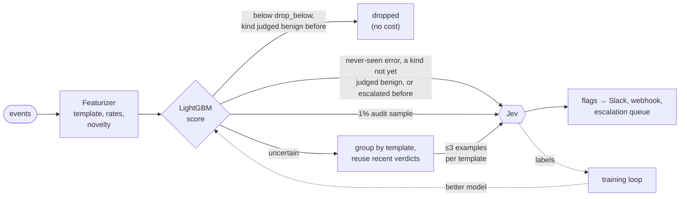

# Triage

cloudfriend decides in two stages. A small classifier looks at every event, and a strong model looks at the few the classifier can't rule out:

1. **The classifier**, a LightGBM model, scores every event as it is parsed. It handles about 30,000 events a second on one core, featurizing included, at no cost per event. Most events score near zero and stop here.
2. **Jev**, the decider, reads the events that pass the classifier and decides what to escalate. It is much better at judgment than the classifier, but every call costs money and takes seconds. So it only sees a few examples of each kind of event.

Each Jev verdict also becomes a training label for the classifier. As the classifier learns from them, it handles more of the stream on its own and fewer events reach Jev. See [Training](./training.md).

Code: `src/triage/` (featurizer, LightGBM evaluator, cascade) and `src/worker.ts` (`parseNew`, `#triageBatch`).

## Stage 1: the classifier

### Features

The featurizer (`src/triage/features.ts`) turns any JSON event into 90 numbers. It needs no schema. It finds the message, service, level, HTTP status and timestamp under the usual field names (`message`, `msg`, `error`, `service`, `container_name`, `level`, `severity`, `status_code`, …) at any depth, and falls back to the event's text.

| Group | What it measures |
| --- | --- |
| Text | level, HTTP status, length, line count, digit and capital ratios, stack-trace frames |
| Keywords | error, exception, failure, timeout, refused, denied, unavailable, crash, null/type errors, warnings, retries, resource exhaustion, data integrity, startup, success, security |
| Template | whether this kind of message has been seen before, how often, how long ago, and its rate over the last minute, 10 minutes and hour |
| Service | the service's event and error rates, its error burst against its own baseline, how many new kinds of message it produced recently |
| Global | overall error burst, new message kinds across all services, how many services are failing at once |
| Words | 32 hashed buckets of the template's words |

The built-in model leaves out the word buckets and the features that only describe how long a service has been watched or how busy the benchmark systems were. Those don't carry over to a system it has never seen. Retraining on your own labels keeps the built-in model's features.

A **template** is the message with its variable parts masked: ids, UUIDs, numbers, hashes, quoted values, `key=value` values, IPs and timestamps. For example, `GetCartAsync called with userId=418ce0b6-…` and `GetCartAsync called with userId=9f1c0b6e-…` share the template `logs|cartservice|GetCartAsync called with userId=<V>`. For tracebacks, the template keeps the first and last lines.

The featurizer remembers templates and services: up to 100,000 templates, least recently seen forgotten first. It saves this history to the database every minute and on shutdown, so a restart doesn't make every message look new.

The classifier also reads a user id and a trace id from each event (`user_id`, `userId`, `user_name`, `?user_id=` in a URL, and so on). Flags list the users involved, and `GET /events?user=<id>` finds the same user's events from every source.

### Routes

The model gives each event a probability that it should be escalated, and the event takes one route:

| Route | When | What happens |
| --- | --- | --- |
| `drop` | score below the model's `drop_below`, and its kind has earned suppression (below) | Done. Not escalated, never sent anywhere. |
| `jev` | score at or above `drop_below` | Goes to Jev in the next batch. |
| `review` | score below `drop_below`, but its kind hasn't earned suppression, or its kind was escalated more than `CLOUDFRIEND_ESCALATED_TTL` ago | Goes to Jev. One example per kind is shown; the rest follow its verdict. |
| `novel` | error-like (error level, error words or a 5xx) and its template has never been seen, whatever its score | Goes to Jev once. Later events of the template are scored normally. Turn off with `CLOUDFRIEND_NOVEL_ERRORS=off`. |
| `known` | an event of its template was judged relevant by Jev, or escalated by a person, in the last `CLOUDFRIEND_ESCALATED_TTL` (7 days), whatever its score | Goes to Jev, where a cached verdict usually adds it to the open flag. The classifier can never drop the next instance of something that was escalated. A person marking the flag `false_positive` ends this for its templates. After the 7 days, the next event of the template is reviewed instead (route `review`), see below. |
| `audit` | a random `CLOUDFRIEND_AUDIT_RATE` (1%) of what would be dropped | Goes to Jev, so its answers measure what the classifier misses. Audits aren't urgent: they ride along with the next batch, or go on their own after `CLOUDFRIEND_AUDIT_WAIT` (5 minutes). |
| `auto` | score at or above `escalate_above` | Escalated without asking Jev. Off in the shipped model (`escalate_above` is above 1). |
| `classifier` | no Jev configured, score at or above the model's `threshold` | Escalated on the classifier alone. |

`drop_below` is chosen when the model is trained: the highest score that still sends 99.5% of the known escalations to Jev (`CLOUDFRIEND_RECALL_TARGET`).

### Suppression is earned

A low score alone doesn't let the classifier drop an event. Its kind, meaning its template at its severity, must have **earned suppression**: Jev or a person judged an event of that kind benign within `CLOUDFRIEND_SUPPRESSION_TTL` (30 days), and the situation hasn't changed materially since. A change means either of these:

- the template is more than 5 times as frequent as when it was judged;
- its service has at least 10 errors in the last 10 minutes and more than 5 times as many as then.

Until then, the event goes to Jev (route `review`). So the first event of every new kind of traffic is looked at once, a kind stops being dropped when it starts happening much more often, and an error-level version of a routine info line is a new kind. The classifier's job is to recognise traffic that has been judged safe to exclude, not to reproduce Jev's reasoning.

A relevant judgment, or a person's escalation, revokes a kind's suppression until it is judged benign again. Suppression also expires after 30 days, and the next event gets a fresh look. A decider that doesn't judge events (an old-style one that only returns flags) never earns suppression, so the classifier never drops on its behalf. `CLOUDFRIEND_SUPPRESSION_TTL=off` turns this off and lets the classifier drop anything below `drop_below`, as before.

The first look costs Jev calls. With a long-running server it happens once per kind, but in the benchmarks' 25-minute cases every kind is new, and Jev read about 2.6 times as many events (see [Benchmarks](./benchmarks.md)).

### Expired protection means review, not drop

An escalated template is protected for `CLOUDFRIEND_ESCALATED_TTL` (7 days): every event of it goes to Jev. After that, for up to `CLOUDFRIEND_ESCALATED_MEMORY` (90 days), its next event goes to Jev once, on route `review`. If Jev judges it relevant, the protection is renewed; if benign, it is retired. Silence never ends it. So a problem that comes back on day 8 meets a fresh review, not a classifier that has forgotten it.

Both survive a restart. Labels store the severity and context they were judged in, and the server rebuilds earned suppression and escalations from them on startup.

`GET /stats` shows how many events took each route, and `GET /events?route=jev` lists them. Every event in the API has its `score` and `route`.

## Stage 2: Jev

Events that pass the classifier wait for a batch, as before: 100 events, or 10 seconds after the oldest arrived. Before anything is sent to Jev, cloudfriend shrinks the batch in two steps:

1. **Recent verdicts.** If Jev ruled on the same template **at the same severity** in the last `CLOUDFRIEND_VERDICT_TTL` (15 minutes), that verdict is reused. Severity is the event's level and its HTTP status class, so an `info` line with status 200 and an `error` line with status 500 never share a verdict, even with the same message. A "yes" adds the event to the flag Jev raised, if that flag is still open or acknowledged. No new flag is raised and nothing is notified again. A template marked `false_positive` by a person gets a cached "no".

   A cached "no" is used more carefully than a "yes", since a wrong one hides a problem:
   - it is stored only when Jev judged every example of that template and severity benign, never from silence;
   - it ends once the template's rate in the last minute is twice its rate when Jev ruled, and at least 5 more a minute. A growing failure gets a fresh look at each doubling, which costs a few calls per burst;
   - it doesn't apply to an event the classifier scores far above the events it was given for, more than 2 in log-odds, since the classifier sees a change;
   - `audit`, `novel`, `known` and `review` events skip it and always reach Jev;
   - a person reporting a missed event (`POST /events/:id/feedback {"escalate": true}`) clears it.
2. **Examples.** At most `CLOUDFRIEND_EXAMPLES_PER_TEMPLATE` (3) events per template are sent, and one for a kind sent only for review. Each carries counts from the featurizer's history, which includes events the classifier dropped: how often the template occurred in the last minute, 10 minutes and hour, its usual rate per hour, when it was first seen, and its service's recent errors. The rest of the template's events take the examples' verdict.

A burst of 2,000 identical errors therefore costs one Jev call, not twenty. In the benchmarks this cut Jev's reading to about 1 line in 2,000 (see [Benchmarks](./benchmarks.md)).

Jev doesn't see the classifier's score, so its judgment stays independent of the model it trains. It answers in two parts:

- **Judgments:** one per event shown, `relevant` (worth a person's attention), `benign` or `uncertain`. These become the training labels; `uncertain` and missing judgments produce none.
- **Alerts:** which relevant events should notify someone now, each with a reason and a severity. The prompt lists the open alerts, and an alert that continues one names it in `update`: its events join that flag and nobody is notified again.

The followers of each alerted example are added to its flag. Each call's prompt and raw reply are stored, and `GET /decisions/:id` returns them. The older reply format (`flags` only) is still accepted. It produces labels only for the events its flags cite, as relevant, and never a "don't escalate".

### The Jev decider

`CLOUDFRIEND_DECIDER=jev` is the default. It sends the batch to TypeSafe's Jev router on OpenRouter:

| Variable | Default | |
| --- | --- | --- |
| `JEV_API_KEY` | `OPENROUTER_API_KEY` | OpenRouter key used for Jev. |
| `JEV_MODEL` | `typesafe/jev-router` | Any OpenRouter model id. The router picks a model per request. |
| `OPENROUTER_BASE_URL` | `https://openrouter.ai/api/v1` | Any OpenAI-compatible endpoint. |

The prompt, the reply format and `CLOUDFRIEND_DECIDER_INSTRUCTIONS` are shared with the `openrouter` decider. Any other decider adapter works in the second stage too. It receives `event.triage = { score, similar, context }` on each example and the open flags in its context, and may return `{ flags, judgments }`. An adapter that returns only flags still works; the events its flags cite become "escalate" labels, and nothing becomes a "don't escalate".

With no decider configured, the classifier escalates on its own at its `threshold`. No labels are produced in that mode.

## The escalation queue

Flags are the queue. Each has a `status`:

| Status | Meaning | Set by |
| --- | --- | --- |
| `open` | new | cloudfriend |
| `acknowledged` | someone is on it | `PATCH /flags/:id {"status": "acknowledged"}` |
| `resolved` | handled | `PATCH /flags/:id {"status": "resolved"}` |
| `confirmed` | it was right to escalate | `POST /flags/:id/feedback {"verdict": "confirmed"}` |
| `false_positive` | it should not have been escalated | `POST /flags/:id/feedback {"verdict": "false_positive"}` |

`GET /queue` returns the open and acknowledged flags, most severe first, then newest, each with its `event_count` and linked `users`. `GET /queue?status=resolved` shows others. Feedback also trains the classifier: see [Training](./training.md).

## Configuration

| Variable | Default | |
| --- | --- | --- |
| `CLOUDFRIEND_TRIAGE` | `on` | `off` sends every event to the decider, as cloudfriend v0 did. No classifier, grouping or labels. |
| `CLOUDFRIEND_MODEL` | | Model file to load. By default the last promoted model (`/data/models/active.json`), else the built-in `models/base.json`. |
| `CLOUDFRIEND_AUDIT_RATE` | `0.01` | Share of dropped events sent to Jev anyway. |
| `CLOUDFRIEND_AUDIT_WAIT` | `5m` | Longest a batch of only audit samples waits for other events. |
| `CLOUDFRIEND_NOVEL_ERRORS` | `on` | Send never-seen error templates to Jev once. |
| `CLOUDFRIEND_ESCALATED_TTL` | `7d` | How long a template that was escalated keeps going to Jev whatever its score. `off` disables. |
| `CLOUDFRIEND_ESCALATED_MEMORY` | `90d` | After that, how long its next event still gets a review instead of being dropped. |
| `CLOUDFRIEND_SUPPRESSION_TTL` | `30d` | How long a benign judgment lets the classifier drop its kind. `off` lets it drop without one. |
| `CLOUDFRIEND_VERDICT_TTL` | `15m` | How long a Jev verdict on a template, at one severity, is reused. |
| `CLOUDFRIEND_EXAMPLES_PER_TEMPLATE` | `3` | Examples of one template per Jev batch. |
