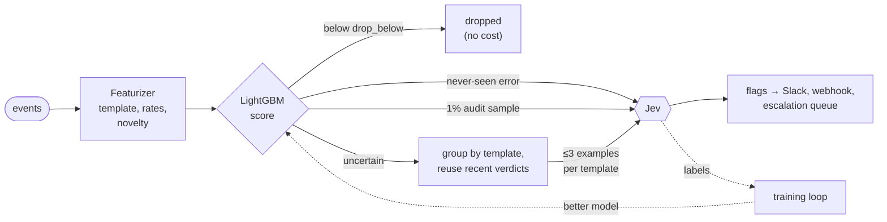

# Triage

cloudfriend decides in two stages. A small classifier looks at every event, and a strong model looks at the few the classifier can't rule out:

1. **The classifier**, a LightGBM model, scores every event as it is parsed. It handles about 30,000 events a second on one core, featurizing included, at no cost per event. Most events score near zero and stop here.
2. **Jev**, the decider, reads the events that pass the classifier and decides what to escalate. It is much better at judgment than the classifier, but every call costs money and takes seconds. So it only sees a few examples of each kind of event.

Each Jev verdict also becomes a training label for the classifier. As the classifier learns from them, it handles more of the stream on its own and fewer events reach Jev. See [Training](./training.md).

Code: `src/triage/` (featurizer, LightGBM evaluator, cascade) and `src/worker.ts` (`parseNew`, `#triageBatch`).

## Stage 1: the classifier

### Features

The featurizer (`src/triage/features.ts`) turns any JSON event into 90 numbers. It needs no schema. It finds the message, service, level, HTTP status and timestamp under the usual field names (`message`, `msg`, `error`, `service`, `container_name`, `level`, `severity`, `status_code`, …) at any depth, and falls back to the event's text.

| Group | What it measures |
| --- | --- |
| Text | level, HTTP status, length, line count, digit and capital ratios, stack-trace frames |
| Keywords | error, exception, failure, timeout, refused, denied, unavailable, crash, null/type errors, warnings, retries, resource exhaustion, data integrity, startup, success, security |
| Template | whether this kind of message has been seen before, how often, how long ago, and its rate over the last minute, 10 minutes and hour |
| Service | the service's event and error rates, its error burst against its own baseline, how many new kinds of message it produced recently |
| Global | overall error burst, new message kinds across all services, how many services are failing at once |
| Words | 32 hashed buckets of the template's words |

The built-in model leaves out the word buckets and the features that only describe how long a service has been watched or how busy the benchmark systems were. Those don't carry over to a system it has never seen. Retraining on your own labels keeps the built-in model's features.

A **template** is the message with its variable parts masked: ids, UUIDs, numbers, hashes, quoted values, `key=value` values, IPs and timestamps. For example, `GetCartAsync called with userId=418ce0b6-…` and `GetCartAsync called with userId=9f1c0b6e-…` share the template `logs|cartservice|GetCartAsync called with userId=<V>`. For tracebacks, the template keeps the first and last lines.

The featurizer remembers templates and services: up to 100,000 templates, least recently seen forgotten first. It saves this history to the database every minute and on shutdown, so a restart doesn't make every message look new.

The classifier also reads a user id and a trace id from each event (`user_id`, `userId`, `user_name`, `?user_id=` in a URL, and so on). Flags list the users involved, and `GET /events?user=<id>` finds the same user's events from every source.

### Routes

The model gives each event a probability that it should be escalated, and the event takes one route:

| Route | When | What happens |
| --- | --- | --- |
| `drop` | score below the model's `drop_below` | Done. Not escalated, never sent anywhere. |
| `jev` | score at or above `drop_below` | Goes to Jev in the next batch. |
| `novel` | error-like (error level, error words or a 5xx) and its template has never been seen, whatever its score | Goes to Jev once. Later events of the template are scored normally. Turn off with `CLOUDFRIEND_NOVEL_ERRORS=off`. |
| `audit` | a random `CLOUDFRIEND_AUDIT_RATE` (1%) of what would be dropped | Goes to Jev, so its answers measure what the classifier misses. |
| `auto` | score at or above `escalate_above` | Escalated without asking Jev. Off in the shipped model (`escalate_above` is above 1). |
| `classifier` | no Jev configured, score at or above the model's `threshold` | Escalated on the classifier alone. |

`drop_below` is chosen when the model is trained: the highest score that still sends 98% of the known escalations to Jev (`CLOUDFRIEND_RECALL_TARGET`).

`GET /stats` shows how many events took each route, and `GET /events?route=jev` lists them. Every event in the API has its `score` and `route`.

## Stage 2: Jev

Events that pass the classifier wait for a batch, as before: 100 events, or 10 seconds after the oldest arrived. Before anything is sent to Jev, cloudfriend shrinks the batch in two steps:

1. **Recent verdicts.** If Jev ruled on the same template in the last `CLOUDFRIEND_VERDICT_TTL` (15 minutes), that verdict is reused. A "no" means the event is done. A "yes" adds the event to the flag Jev raised, if that flag is still open or acknowledged. No new flag is raised and nothing is notified again. A template marked `false_positive` by a person gets a cached "no".
2. **Examples.** At most `CLOUDFRIEND_EXAMPLES_PER_TEMPLATE` (3) events per template are sent. Each shows Jev how many similar events it stands for (`similar_events_not_shown=40`), and the rest take its verdict.

A burst of 2,000 identical errors therefore costs one Jev call, not twenty. In the benchmarks this cut Jev's reading to about 1 line in 2,000 (see [Benchmarks](./benchmarks.md)).

Jev's reply is the same as any decider's: flags with a reason, a severity and the events behind them. The followers of each flagged example are added to its flag.

### The Jev decider

`CLOUDFRIEND_DECIDER=jev` is the default. It sends the batch to TypeSafe's Jev router on OpenRouter:

| Variable | Default | |
| --- | --- | --- |
| `JEV_API_KEY` | `OPENROUTER_API_KEY` | OpenRouter key used for Jev. |
| `JEV_MODEL` | `typesafe/jev-router` | Any OpenRouter model id. The router picks a model per request. |
| `OPENROUTER_BASE_URL` | `https://openrouter.ai/api/v1` | Any OpenAI-compatible endpoint. |

The prompt, the reply format and `CLOUDFRIEND_DECIDER_INSTRUCTIONS` are shared with the `openrouter` decider. Any other decider adapter works in the second stage too. It receives `event.triage = { score, similar }` on each example.

With no decider configured, the classifier escalates on its own at its `threshold`. No labels are produced in that mode.

## The escalation queue

Flags are the queue. Each has a `status`:

| Status | Meaning | Set by |
| --- | --- | --- |
| `open` | new | cloudfriend |
| `acknowledged` | someone is on it | `PATCH /flags/:id {"status": "acknowledged"}` |
| `resolved` | handled | `PATCH /flags/:id {"status": "resolved"}` |
| `confirmed` | it was right to escalate | `POST /flags/:id/feedback {"verdict": "confirmed"}` |
| `false_positive` | it should not have been escalated | `POST /flags/:id/feedback {"verdict": "false_positive"}` |

`GET /queue` returns the open and acknowledged flags, most severe first, then newest, each with its `event_count` and linked `users`. `GET /queue?status=resolved` shows others. Feedback also trains the classifier: see [Training](./training.md).

## Configuration

| Variable | Default | |
| --- | --- | --- |
| `CLOUDFRIEND_TRIAGE` | `on` | `off` sends every event to the decider, as cloudfriend v0 did. No classifier, grouping or labels. |
| `CLOUDFRIEND_MODEL` | | Model file to load. By default the last promoted model (`/data/models/active.json`), else the built-in `models/base.json`. |
| `CLOUDFRIEND_AUDIT_RATE` | `0.01` | Share of dropped events sent to Jev anyway. |
| `CLOUDFRIEND_NOVEL_ERRORS` | `on` | Send never-seen error templates to Jev once. |
| `CLOUDFRIEND_VERDICT_TTL` | `15m` | How long a Jev verdict on a template is reused. |
| `CLOUDFRIEND_EXAMPLES_PER_TEMPLATE` | `3` | Examples of one template per Jev batch. |
